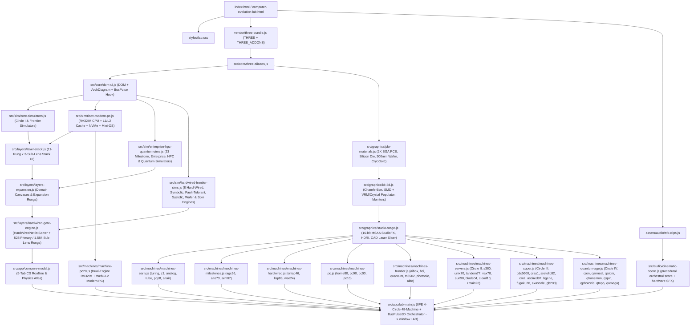

# System & Module Architecture (v6.0.0)

## 1. Execution & Script Loading Graph

To guarantee **zero-CORS direct `file://` execution** when double-clicking `computer-evolution-lab.html` (as well as standard HTTP serving via `tools/serve.mjs` and embedded loopback serving in `Computer Evolution Lab.exe`), the application loads 26 classic deferred scripts in deterministic dependency order:

---

## 2. Four-Circle Spatial Campus Topology (`48` Operational Machines)

`src/app/lab-main.js` arranges the 48 machines chronologically across 4 Grand Plazas (`PLAZAS.c1..c4`) over the derivative-antialiased metric floor, linked by live 3D light-bridge wave-packets (`BusPulse3D`):

- **Circle I (`[0, 0, -7.2]`, `22` machines)**: Personal, Hard-Wired, Symbolic & Wafer-Scale Frontier surrounding **★ 1975 MOS 6502 (`m6502`)** on a raised central dais (`turing`, `z1`, `eniac46`, `analog`, `tube`, `pdp8`, `agc66`, `alto73`, `altair`, `m6502`, `home80`, `lisp83`, `pc90`, `pc00`, `arm07`, `pc10`, `pc20`, `aibox`, `bci`, `wse24`, `alife`, `photonic`).
- **Circle II (`[-19.2, 0, 5.8]`, `8` machines)**: Mainframes & Enterprise Servers surrounding **★ 1964 IBM System/360 (`s360`)** (`s360`, `unix70`, `tandem77`, `vax78`, `sun90`, `blade04`, `cloud10`, `zmain20`).
- **Circle III (`[19.2, 0, 5.8]`, `9` machines)**: Supercomputers surrounding **★ 1976 Cray-1 Vector (`cray1`)** (`cdc6600`, `cray1`, `systolic82`, `cm2`, `ascired97`, `bgene`, `fugaku20`, `exascale`, `gb200`).
- **Circle IV (`[0, 0, 16.4]`, `9` machines)**: The Age of Quantum Computers surrounding **★ 2045+ OMEGA-Q Horizon (`qomega`)** (`qion`, `quantum`, `qanneal`, `qatom`, `qtransmon`, `qspin`, `qphotonic`, `qtopo`, `qomega`).

---

## 3. Dual-Engine Modern PC (`pc20`) Bus Topology

Inside `src/sim/riscv-modern-pc.js` and `src/machines/machine-pc20.js`, the CPU and GPU simulators communicate every animation frame over memory-mapped I/O:

- **`0x00000000 – 0x0000FFFF` (64 KB Unified Low RAM)**: Code `.text` (`0x0000`), `.data` (`0x2000`), and downward-growing stack (`sp = 0xEFFC`), accessed through `L1I` (2 KB, 4-way), `L1D` (4 KB, 4-way), and `L2` (16 KB, 8-way) LRU caches.
- **`0x10000000 – 0x1000001F` (UART Console & 3D Mechanical Keyboard)**:
  - `0x10000000` (`TX_CHAR`) & `0x10000004` (`TX_INT`): Streams ASCII/integer output to the Mini-OS terminal and 4K 3D monitor.
  - `0x10000008` (`RX_READY`) & `0x1000000C` (`RX_DATA`): Pops real ASCII keystrokes pushed by clicking physical 3D keycaps on the desk or typing in the terminal.
- **`0x20000000 – 0x2000001F` (PCIe 5.0 GPU Co-Processor MMIO)**:
  - Four 32-bit registers (`gpuRegs[0..3]`) scaled by `1/256` and uploaded as `uniform vec4 uCPU` into the WebGL2 GLSL ES 3.0 fragment shader (`512×512` ping-pong render targets).
- **`0x30000000 – 0x3000001F` (NVMe Gen5 Block DMA)**:
  - Transfers 256-byte flash blocks between simulated NAND storage and main RAM while pulsing the M.2 controller activity LED.

---

## 4. 4K HDR Rendering & Anti-Aliasing Pipeline

1. **Scene Illumination**: Three-point studio softbox equirectangular PMREM environment (`buildStudioEnvironmentScene`) paired with shadow-casting key light (`2048×2048` `PCFSoftShadowMap`), cool rim light, and warm bounce fill.
2. **Dielectric & Cutaway Calibration**: `calibrateDielectricColor()` clamps non-metallic diffuse albedos below `0.80` luminance so high-key enclosures retain surface shading gradients, while `applyCutawayOpacity()` attenuates `opacity`, `clearcoat`, and `envMapIntensity` on `shell: true` enclosures so internal hardware remains glare-free during Cutaway inspection.
3. **Post-Processing (`StudioFX`)**: Renders into a `HalfFloatType` `WebGLRenderTarget` with hardware `samples: 4` MSAA (`Ultra` / `High`), subtle high-threshold `UnrealBloomPass` (`threshold: 0.90`, `strength: 0.22` in `High`), `OutputPass` (`ACESFilmicToneMapping`, `exposure: 0.96`), and optional `SMAAPass` fallback when MSAA is disabled on `Medium`.

## v6.0.0 modules

| File                              | Role                                                                                                                                            |
| :-------------------------------- | :---------------------------------------------------------------------------------------------------------------------------------------------- |
| `src/core/boot-guard.js`          | Boot watchdog, moved out of `index.html` for the CSP                                                                                            |
| `src/assets/asset-locator.js`     | `CelAssets`: reads `assets/tier.json` and builds the texture, HDRI, stem and SFX paths. On `file://` nothing external loads                     |
| `src/graphics/pbr-assets.js`      | `CelPBR`: wraps the `U.*` material factories with CC0 detail maps (world-box UVs) and loads the HDRI. Swaps happen only after a successful load |
| `src/graphics/pbr-materials.js`   | `U.screen(tex, {crt                                                                                                                             | lcd})`: CRT/LCD display shaders |
| `src/graphics/studio-stage.js`    | `StudioFX`: quality tiers, GTAO, SMAA, selective bloom, DoF, Ultra supersampling                                                                |
| `src/graphics/die-detail-6502.js` | `CelDieDetail`: transistor-scale close-zoom patch for the 6502 die                                                                              |
| `src/audio/stem-score.js`         | `StemScoreEngine`: 18 sampled cues × 3 stems, with the procedural score as fallback                                                             |
| `src/app/hub-proxy-sizes.js`      | Proxy box sizes for the lazy hub (`tools/gen-hub-proxy-sizes.mjs`)                                                                              |
| `src/app/lab-main.js`             | `deviceClass`, `hubMode`, `ensureBuilt` / `showFull` / LRU disposal                                                                             |
