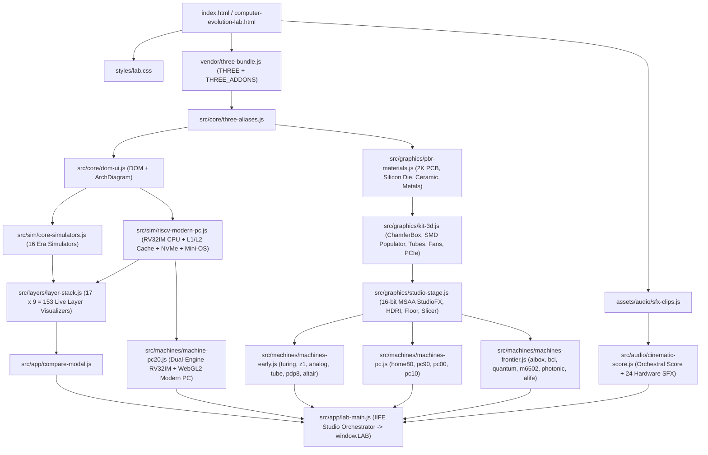

# System & Module Architecture

## 1. Execution & Script Loading Graph

To guarantee **zero-CORS direct `file://` execution** when double-clicking `computer-evolution-lab.html` (as well as standard HTTP serving via `tools/serve.mjs`), the application loads classic deferred scripts in deterministic dependency order:

---

## 2. Dual-Engine Modern PC (`pc20`) Bus Topology

Inside `src/sim/riscv-modern-pc.js` and `src/machines/machine-pc20.js`, the CPU and GPU simulators communicate every animation frame over memory-mapped I/O:

- **`0x00000000 – 0x0000FFFF` (64 KB Unified Low RAM)**: Code `.text` (`0x0000`), `.data` (`0x2000`), and downward-growing stack (`sp = 0xEFFC`), accessed through `L1I` (2 KB, 4-way), `L1D` (4 KB, 4-way), and `L2` (16 KB, 8-way) LRU caches.
- **`0x10000000 – 0x1000001F` (UART Console & 3D Mechanical Keyboard)**:
  - `0x10000000` (`TX_CHAR`): Appends ASCII output to the Mini-OS terminal and 4K 3D monitor.
  - `0x10000004` (`TX_INT`): Prints signed 32-bit integers.
  - `0x10000008` (`RX_READY`) & `0x1000000C` (`RX_DATA`): Pops real ASCII keystrokes pushed by clicking physical 3D keycaps on the desk or typing in the terminal.
- **`0x20000000 – 0x2000001F` (PCIe 5.0 GPU Co-Processor MMIO)**:
  - Four 32-bit registers (`gpuRegs[0..3]`) scaled by `1/256` and uploaded as `uniform vec4 uCPU` into the WebGL2 GLSL ES 3.0 fragment shader (`512×512` ping-pong render targets).
  - Framebuffer readback samples 48 tiles onto the 3D AD104 GPU die's Streaming Multiprocessor array and exposes pixel RGBA values to the `Bits` software layer.
- **`0x30000000 – 0x3000001F` (NVMe Gen5 Block DMA)**:
  - Transfers 256-byte flash blocks between simulated NAND storage and main RAM while pulsing the M.2 controller activity LED.

---

## 3. 4K HDR Rendering & Anti-Aliasing Pipeline

1. **Scene Illumination**: Three-point studio softbox equirectangular PMREM environment (`buildStudioEnvironmentScene`) paired with shadow-casting key light (`2048×2048` `PCFSoftShadowMap`), cool rim light, and warm bounce fill.
2. **Dielectric Albedo Calibration**: `calibrateDielectricColor()` clamps non-metallic diffuse albedos below `0.80` luminance so high-key enclosures and white keycaps retain crisp surface shading gradients.
3. **Post-Processing (`StudioFX`)**: Renders into a `HalfFloatType` `WebGLRenderTarget` with hardware `samples: 4` MSAA (`Ultra` / `High`), subtle high-threshold `UnrealBloomPass` (`threshold: 0.90`, `strength: 0.22` in `High`), `OutputPass` (`ACESFilmicToneMapping`, `exposure: 0.96`), and optional `SMAAPass` fallback when MSAA is disabled on `Medium`.
